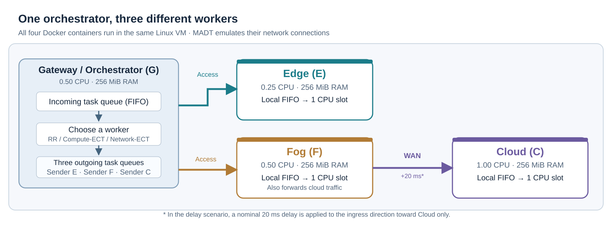
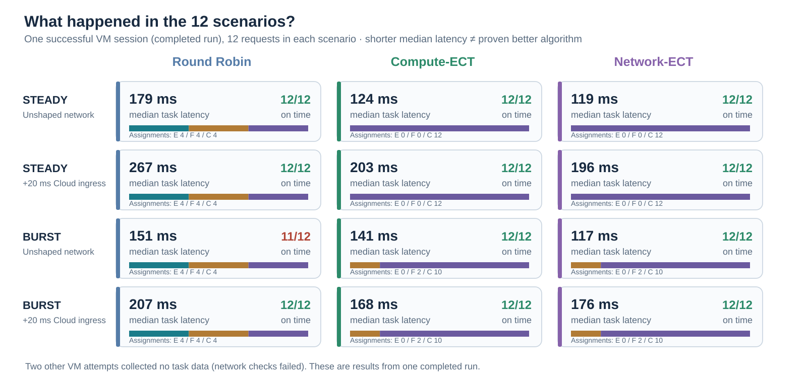
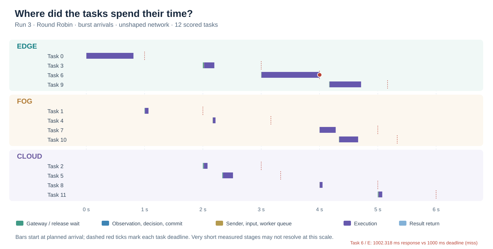

# Scheduling tasks across different computing resources

**Research prototype · UPV/EHU · October 2026**

**The idea.** An *orchestrator* is a program that receives computing tasks and decides which available machine should execute each one. I built a small prototype to study how network delay, computing power and queues affect that decision.

The results below show a **working implementation and preliminary measurements**. They do not yet prove which scheduling algorithm is best.

## 1. The computing environment

The three worker roles refer to **where computing resources are placed in a network**:

- **Edge:** computing close to where the request originates. It usually offers short communication paths, but can have limited processing power.
- **Fog:** an intermediate computing layer between Edge and Cloud. Here, it also forwards traffic to the Cloud.
- **Cloud:** more distant computing resources that can offer higher capacity, but may require longer data transfers.

These are logical **roles**, not three separate physical locations in my experiment.

**MADT (Distributed Application Modelling System)** is an open-source tool for deploying applications into an emulated IP-network topology and controlling network conditions such as delay and bandwidth. I use [MADT](https://github.com/dltcspbu/madt) to create the network connections and impairments while running real application code; this is **network emulation, not four independent physical sites**. To reproduce network conditions in a controlled way, I run four isolated **Docker containers inside one Linux virtual machine**, connected through a network emulator. A *CPU quota* limits how much processing time a container may use.

| Container | What it does | CPU quota |
|---|---|---:|
| Gateway / orchestrator | Receives tasks and selects workers | 0.50 CPU |
| Edge worker | Executes tasks locally | 0.25 CPU |
| Fog worker | Executes tasks and forwards Cloud traffic | 0.50 CPU |
| Cloud worker | Executes tasks after traffic passes through Fog | 1.00 CPU |

Every container is limited to **256 MiB of memory**. A **queue** is where work waits until it can proceed; *FIFO* means tasks are handled in arrival order (*first in, first out*). The Gateway has a waiting queue and one outgoing queue per worker; each worker has a local FIFO and **one execution slot**. Choosing a worker does not imply immediate execution.

Traffic to Cloud follows **Gateway → Fog → Cloud**, while Edge can be reached directly on the access network.

## 2. What kind of task do I send?

I use a **deterministic CPU-heavy calculation**, not an artificial sleep.

**PBKDF2-HMAC-SHA256** is normally a method for deriving a cryptographic key. It repeatedly applies a SHA-256-based keyed hash for a specified number of iterations. **More iterations mean more repeated CPU work.** Here I use it only as a controlled workload: the same input and iteration count produce the same output, which lets the Gateway verify every worker's answer. I am *not* evaluating cryptographic security.

Each task combines one of two **input sizes** (64 KiB or 1 MiB) with one of two **CPU work levels** (200,000 or 800,000 hash iterations). This gives **four task types**. The input is actually transferred over the emulated network, then the worker performs the calculation and returns a verifiable result.

For scoring I use a simple **one-second deadline**, measured from the task's planned arrival. This is an illustrative experimental target, not a production service requirement.

## 3. How does the orchestrator choose a worker?

A *scheduling algorithm* decides where to send a task. I implemented three simple choices:

- **Round Robin (RR):** takes turns assigning tasks to workers that have capacity available. It does not try to predict execution time.
- **Compute-ECT:** *ECT means Earliest Completion Time*. It estimates when each worker would finish the task using its computing speed and known queued work, **without including transfer cost**.
- **Network-ECT:** uses a similar completion-time estimate, but **also includes expected time to send the input and return the result**.

Both ECT algorithms make predictions from information available to the orchestrator at decision time; neither knows future task completion times.

I compare these algorithms with two task-arrival patterns:

- **Steady:** approximately one task every 0.5 seconds.
- **Burst:** tasks arrive close together in two short bursts, creating opportunities for queueing.

I also compare **normal networking** with a condition that adds a nominal **20 ms delay only toward Cloud** (not symmetrically to every link).

That makes **3 algorithms × 2 arrival patterns × 2 network conditions = 12 scenarios**, each offering 12 tasks over 6 seconds.

## 4. Three concrete examples

Here are three comparisons under **matched conditions**: in each example, the arrival pattern and network setting are the same for all three schedulers. Every row represents **12 real tasks from one completed run**, not an independent VM session.

**Example A — Steady arrivals, normal network.** Tasks are spaced apart, so the workers have relatively little queueing.

| Scheduler | Assigned tasks: Edge / Fog / Cloud | Median latency |
|---|---:|---:|
| Round Robin | 4 / 4 / 4 | 179.5 ms |
| Compute-ECT | 0 / 0 / 12 | 124.1 ms |
| Network-ECT | 0 / 0 / 12 | 119.3 ms |

**Example B — Bursty arrivals, normal network.** Tasks arrive closer together, making worker queues more important.

| Scheduler | Assigned tasks: Edge / Fog / Cloud | Finished within 1 s |
|---|---:|---:|
| Round Robin | 4 / 4 / 4 | 11 / 12 |
| Compute-ECT | 0 / 2 / 10 | 12 / 12 |
| Network-ECT | 0 / 2 / 10 | 12 / 12 |

**Example C — Bursty arrivals, 20 ms added toward Cloud.** The Cloud input route now has an additional directional delay.

| Scheduler | Assigned tasks: Edge / Fog / Cloud | Median latency |
|---|---:|---:|
| Round Robin | 4 / 4 / 4 | 207.2 ms |
| Compute-ECT | 0 / 2 / 10 | 167.8 ms |
| Network-ECT | 0 / 2 / 10 | 176.0 ms |

**Interpretation:** Round Robin spreads work across available workers. Under this small workload, the ECT policies tend to choose Cloud, sometimes Fog, even when Cloud has added network latency. These are **descriptive examples**, not evidence that a policy is consistently better.

### Complete set of 12 scenarios

The table below covers **every tested combination** in the one fully completed run. E/F/C are numbers of tasks assigned to Edge/Fog/Cloud. The latency column is the *median time from planned arrival to verified response*. A result of 11/12 means one task missed the 1-second deadline.

| Arrival pattern | Network | Scheduler | Median latency | Tasks on time | E / F / C |
|---|---|---|---:|---:|---:|
| Steady | Normal | Round Robin | 179.5 ms | 12/12 | 4 / 4 / 4 |
| Steady | Normal | Compute-ECT | 124.1 ms | 12/12 | 0 / 0 / 12 |
| Steady | Normal | Network-ECT | 119.3 ms | 12/12 | 0 / 0 / 12 |
| Steady | +20 ms Cloud ingress | Round Robin | 267.2 ms | 12/12 | 4 / 4 / 4 |
| Steady | +20 ms Cloud ingress | Compute-ECT | 203.0 ms | 12/12 | 0 / 0 / 12 |
| Steady | +20 ms Cloud ingress | Network-ECT | 196.2 ms | 12/12 | 0 / 0 / 12 |
| Burst | Normal | Round Robin | 151.1 ms | **11/12** | 4 / 4 / 4 |
| Burst | Normal | Compute-ECT | 140.9 ms | 12/12 | 0 / 2 / 10 |
| Burst | Normal | Network-ECT | 117.4 ms | 12/12 | 0 / 2 / 10 |
| Burst | +20 ms Cloud ingress | Round Robin | 207.2 ms | 12/12 | 4 / 4 / 4 |
| Burst | +20 ms Cloud ingress | Compute-ECT | 167.8 ms | 12/12 | 0 / 2 / 10 |
| Burst | +20 ms Cloud ingress | Network-ECT | 176.0 ms | 12/12 | 0 / 2 / 10 |

**What happened:** Round Robin distributed tasks evenly; the two predictive schedulers usually sent most tasks to Cloud. Adding delay changed measured completion times, but **these are single-session observations, not evidence of a general performance ranking**.

## 5. What did I measure?

Before an application run, I check the network emulator's **delay, bandwidth limit, routing, disconnection/reconnection and unaffected access path**.

Once the network check passes, one full run contains:

| Stage | Executions | What it checks |
|---|---:|---|
| Calibration | 72 | Estimate worker and transfer times before the comparison |
| Queue check | 12 | Confirm tasks genuinely wait behind busy workers |
| Warmup | 720 | Put every scenario through the same preparation procedure |
| **Main comparison** | **144** | Compare the 12 scenarios (12 tasks each) |
| **Total real work** | **948** | Includes preparation, not just the scored comparison |

For the main comparison I record **correct results**, **deadline success**, **end-to-end latency** (from planned arrival to verified reply), **worker selection**, **queue waiting** and **scheduling overhead** (time spent deciding). *Median latency* means the middle task duration in a scenario; it does not describe every individual task.

## 6. What happened in the experiment?

I attempted the experiment three times, starting a fresh Linux VM for each attempt.

| Attempt | Result |
|---|---|
| First | The measured network delay exceeded the pre-set upper limit of 25 ms by **0.582 ms**; application measurements did not start |
| Second | Another network check exceeded that limit by **0.448 ms**; application measurements did not start |
| Third | The network checks passed and **all 12 application scenarios completed** |

In the **completed run**, the Gateway made **144 scheduling decisions**. **All 144 scored tasks returned correct answers**, and **143 completed within one second**. Of these tasks, **16 ran on Edge, 24 on Fog and 104 on Cloud**.

The overview reports the actual **median latency**, **tasks meeting the deadline**, and **assignments to each worker** for every scenario. These are **measurements from one completed run**, not averages across three successful repetitions.

## 7. How do individual tasks behave?

A *timeline* shows when a task was released, waited, transferred, executed and returned. All colored segments below use **actual measured time**.

**Example 1 — Round Robin during a burst (normal network).** All three workers receive four tasks. One Edge task takes **1,022.6 ms** from planned release to verified result, just over the 1,000 ms deadline. The graph preserves that missed deadline rather than hiding it.

**Example 2 — Compute-ECT with steady arrivals (normal network).** The scheduler assigns **all 12 tasks to Cloud**. Median completion time is **124.1 ms**, with **12/12** tasks meeting the deadline. This illustrates that estimated processing capacity can influence placement even when Edge and Fog are available.

**Example 3 — Network-ECT with burst arrivals and added Cloud delay.** The algorithm assigns **10 tasks to Cloud and 2 to Fog**, with **12/12** meeting the deadline and **176.0 ms** median completion time. It accounts for expected network costs, but this does not mean it always avoids Cloud.

The timeline visualizes Example 1; the other examples are **measured scenario summaries**, not additional task-level diagrams. They come from the same successful run. Together, they illustrate different placement decisions without establishing which policy is generally best.

## 8. Current conclusion

**Demonstrated:** I have a functioning orchestrator that distributes actual CPU work over three workers with different processing limits, communicates over controlled network paths, and records real waiting, execution and decision times.

**Not demonstrated yet:** reliable **repeatability**, meaning the whole application experiment completes consistently across independently started VM sessions. Two of three attempts stopped at strict network checks. I also cannot conclude that one scheduler consistently outperforms the others from this small pilot.

**Next step:** repeat the application experiment using a prospectively specified procedure that reports **functional correctness** separately from **network-emulation accuracy**, without changing or erasing the earlier failures.

*These figures use already collected data. No new measurements were produced for this summary.*

## References

1. Wang et al. (2026). 'Fair Comparison of Scheduling Algorithms on Heterogeneous Edge Clusters: A Continuous Adaptive Benchmark.' IEEE ICDCSW 2026. [DOI](https://doi.org/10.1109/ICDCSW72724.2026.00054). This is a methodological reference, not a reproduced AI-inference benchmark.
2. [MADT](https://github.com/dltcspbu/madt). Open-source network emulation for controlled testbed connections.

*Personal preliminary research summary. Not peer reviewed or an official statement by UPV/EHU.*
