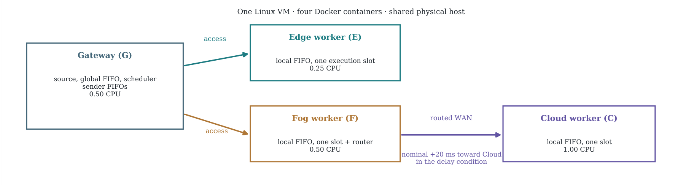
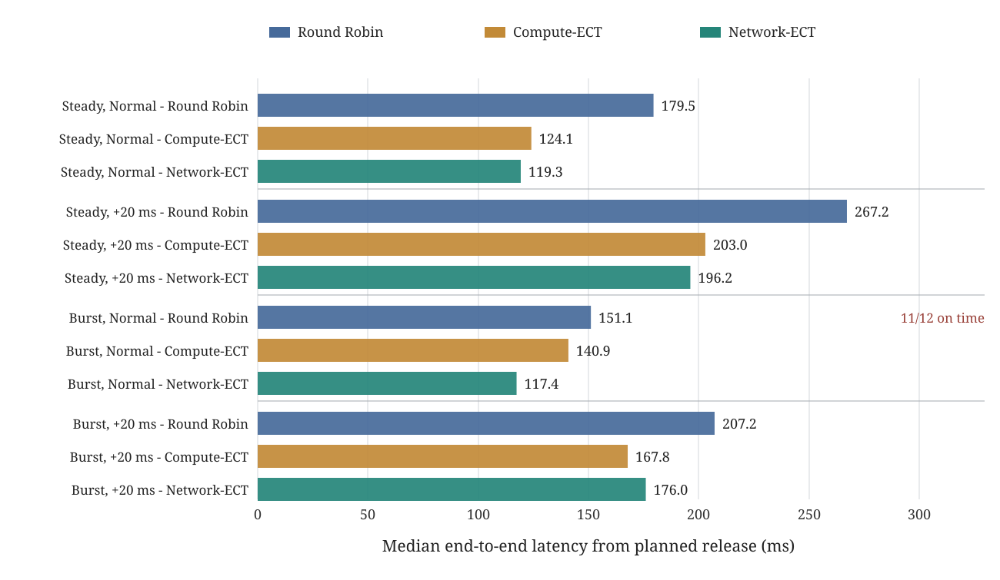
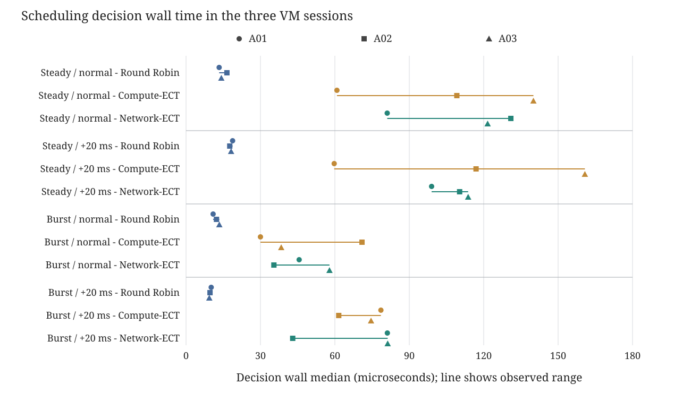

# Scheduling tasks across different computing resources

**Research prototype · UPV/EHU · October 2026**

**The idea.** An *orchestrator* is a program that receives computing tasks and decides which available machine should execute each one. I built a small prototype to study how network delay, computing power and queues affect that decision.

The results below come from **three fresh Linux VM runs**, each running the same experiment once. All three completed. They demonstrate a working implementation under repeated starts on one host; they do not establish which scheduling algorithm is best.

## Research context and relation to Wang et al. (2026)

Wang et al. [1] motivate fair comparisons of scheduling algorithms on the same infrastructure, under different workload conditions, with service-level outcomes and decision overhead reported separately. I follow those **evaluation principles** in a smaller placement experiment with three CPU-limited workers, actual task queues, and emulated network delay.

This is **not a reproduction** of their Continuous Multi-Mode Scheduling (CMMS) benchmark. Their system chooses both an execution node and an AI inference mode, and includes output quality in its objectives. My system chooses only a worker for a fixed CPU task. Their heterogeneous physical testbed and my single-VM emulation are also not equivalent. The present results demonstrate a working experimental prototype, not a general policy advantage.

## 1. The computing environment

The three worker roles refer to **where computing resources are placed in a network**:

- **Edge:** computing close to where the request originates. It usually offers short communication paths, but can have limited processing power.
- **Fog:** an intermediate computing layer between Edge and Cloud. Here, it also forwards traffic to the Cloud.
- **Cloud:** more distant computing resources that can offer higher capacity, but may require longer data transfers.

These are logical **roles**, not three separate physical locations in my experiment.

**MADT (Distributed Application Modelling System)** is an open-source tool for deploying applications into an emulated IP-network topology and controlling network conditions such as delay and bandwidth. I use [MADT](https://github.com/dltcspbu/madt) to create the network connections and impairments while running real application code; this is **network emulation, not four independent physical sites**. To reproduce network conditions in a controlled way, I run four isolated **Docker containers inside one Linux virtual machine**, connected through a network emulator. A *CPU quota* limits how much processing time a container may use.

\input{report/tables/topology.tex}

Each session uses a fresh ARM64 Linux VM with **4 virtual CPUs, 4 GiB RAM and a 20 GiB sparse disk**. The three VMs ran sequentially on the same Apple Silicon Mac. They are separate VM sessions, not independent physical hosts.

Every container is limited to **256 MiB of memory**. A **queue** is where work waits until it can proceed; *FIFO* means tasks are handled in arrival order (*first in, first out*). The Gateway has a waiting queue and one outgoing queue per worker; each worker has a local FIFO and **one execution slot**. Choosing a worker does not imply immediate execution.

Traffic to Cloud follows **Gateway → Fog → Cloud**, while Edge can be reached directly on the access network.

## 2. What kind of task do I send?

I use a **deterministic CPU-heavy calculation**, not an artificial sleep.

**PBKDF2-HMAC-SHA256** is normally a method for deriving a cryptographic key. It repeatedly applies a SHA-256-based keyed hash for a specified number of iterations. **More iterations mean more repeated CPU work.** Here I use it only as a controlled workload: the same input and iteration count produce the same output, which lets the Gateway verify every worker's answer. I am *not* evaluating cryptographic security.

Each task combines one of two **input sizes** (64 KiB or 1 MiB) with one of two **CPU work levels** (200,000 or 800,000 hash iterations). This gives **four task types**. The input is actually transferred over the emulated network, then the worker performs the calculation and returns a verifiable result.

For scoring I use a simple **one-second deadline**, measured from the task's planned arrival. This is an illustrative experimental target, not a production service requirement.

## 3. How does the orchestrator choose a worker?

A *scheduling algorithm* decides where to send a task. I implemented three simple choices:

- **Round Robin (RR):** takes turns assigning tasks to workers that have capacity available. It does not try to predict execution time.
- **Compute-ECT:** *ECT means Earliest Completion Time*. It estimates when each worker would finish the task using its computing speed and known queued work, **without including transfer cost**.
- **Network-ECT:** uses a similar completion-time estimate, but **also includes expected time to send the input and return the result**.

Both ECT algorithms make predictions from information available to the orchestrator at decision time; neither knows future task completion times. Processing and transfer profiles are calibrated separately before comparison in each VM, then held fixed. The algorithms and task streams remain unchanged across sessions, but calibration and measured queue state can lead to different placements.

I compare these algorithms with two task-arrival patterns:

- **Steady:** approximately one task every 0.5 seconds.
- **Burst:** tasks arrive close together in two short bursts, creating opportunities for queueing.

I compare **normal networking** with a second condition in which the network emulator adds a nominal **20 ms one-way delay to packets entering Cloud from Fog**. It affects the input path toward Cloud, not every link or the return path. Measured end-to-end task latency can change by a different amount because execution and queue waiting also contribute.

That makes **3 algorithms × 2 arrival patterns × 2 network conditions = 12 scenarios**, each offering 12 tasks over 6 seconds.

## 4. Three concrete examples

Each example holds the arrival pattern and network condition fixed across policies. **Run 1, Run 2 and Run 3 each use a fresh VM.** Each latency is the median of 12 tasks in that session; 'On time' gives the descriptive total out of 36 offers across the three sessions. Those tasks are not 36 independent repetitions.

\Needspace{110pt}

**Example A - Steady arrivals, normal network.** Tasks are spaced apart, so the workers have relatively little queueing.

\input{report/tables/example-a.tex}

\Needspace{110pt}

**Example B - Bursty arrivals, normal network.** The arrival stream is concentrated into two short bursts. The single missed deadline occurred in Run 3 with Round Robin.

\input{report/tables/example-b.tex}

\Needspace{110pt}

**Example C - Bursty arrivals, +20 ms toward Cloud.** The input route to Cloud has additional one-way delay.

\input{report/tables/example-c.tex}

**Interpretation:** Round Robin spreads work across the available workers. The ECT policies usually choose Cloud, sometimes Fog, under this small workload. Every observed ECT latency median was below its matched Round Robin median, but both ECT policies also spent more time deciding. These are descriptive observations from three sessions, not an established performance ranking.

\Needspace{260pt}

### Complete set of 12 scenarios

The table includes **all tested combinations in all three sessions**. +20 ms means nominal extra one-way Cloud ingress delay. Each run column is a 12-task median in milliseconds, measured from planned arrival to verified response. 'On time' retains the one-second deadline and all 36 offers per row. Per-run placements and individual tasks are available in the public data. In the graph, each symbol is one run's 12-task median. The horizontal segment connects the shortest and longest of the three medians: a wider separation means more variation between runs. It is not a confidence interval.

\input{report/tables/all-scenarios.tex}

## 5. What did I measure?

The procedure and dependency baseline were specified before collection and independently reviewed. Each VM used the same pinned software, four-container topology, CPU limits, task streams and scenario order. **Each session was attempted once, without retries or tuning.** The public repository provides the execution source, package pins and commands.

Before application work, I check the emulator's delay, bandwidth limit, routes, disconnection/reconnection and unaffected path. Application correctness and network fidelity are assessed separately. After collection, I verify the evidence export and VM cleanup before finalizing eligibility for comparison.

One full session contains:

\input{report/tables/stages.tex}

I record correct results, deadline success, end-to-end latency, worker selection, queue waiting and scheduling overhead. **Decision wall time** is elapsed time spent deciding; **decision CPU time** counts CPU used by that thread. Worker execution and communication time remain separate.

\Needspace{100pt}

Across the 36 scenario/session points, decision wall medians ranged from **9.375 to 160.792 microseconds**; decision CPU medians ranged from **6.459 to 146.083 microseconds**. In all 24 matched ECT-minus-Round-Robin comparisons, the ECT decision wall and CPU medians were higher. This overhead is retained alongside the lower response medians; it is not subtracted from the measured response.

## 6. What happened in the experiment?

All three prospectively listed sessions completed their 12 scenarios. All scored tasks returned correct answers; none was rejected, failed or unresolved.

\input{report/tables/sessions.tex}

The Gateway recorded **948 assignments per session**, including 144 scored decisions. The worker totals below include calibration, queue checks and warmup; scored counts are shown in parentheses.

\input{report/tables/nodes.tex}

Both health and application network checks passed the original limits in all three sessions. The application-quota measurements were:

\input{report/tables/network.tex}

The nominal settings were 20 ms added delay and a separate 10 Mbps qualification limit. The original accepted bands were **15-25 ms** for the delay increment and **7-11 Mbps** for the limited receive rate; baseline, restoration, route and unaffected-path checks also passed. The rate limit was a network qualification check, not a third scheduling condition.

\Needspace{120pt}

**Repeatability has limits.** Across the three VM medians for a fixed scenario, the relative range was **0.219%-31.267%**, calculated as (maximum minus minimum) divided by their median. The largest spread was Network-ECT with steady arrivals and added Cloud delay: **196.273, 207.037 and 145.668 ms**. The variation shows why completing the same experiment correctly does not imply identical response times.

All scenarios completed 12 tasks inside the six-second window, giving **2 completed tasks/s**. This small offered workload does not measure maximum processing capacity. On-time goodput was 2 tasks/s except the Run 3 late-task scenario, where it was 11/6 tasks/s.

## 7. How do individual tasks behave?

A *timeline* shows when a task was released, waited, transferred, executed and returned. The figure uses **all 12 actual tasks from Run 3 with Round Robin, burst arrivals and normal networking**, chosen to show the only deadline miss rather than hide it. Each colored segment is measured elapsed time; the small scheduling stages remain included.

**The late Edge task** took **1,002.318 ms** from planned arrival to verified response, exceeding the 1,000 ms deadline by **2.318 ms**. Its actual release was 4.019 ms late. Measuring from that actual release would give 998.299 ms and hide the miss, so the original planned-arrival rule is retained. Its answer was correct.

The measurements do not isolate the cause of this delay. Worker CPU limits, host/guest scheduling and measurement activity can all affect elapsed time; this study did not vary them independently.

\Needspace{260pt}

## 8. Current conclusion

**Demonstrated:** the same application orchestrator completed in **three fresh VM sessions on one host**, with correct task accounting and outputs on every worker, separately qualified network conditions, intact evidence and verified cleanup. Across the full procedure there were **2,844 correct worker results**; among the **432 scored offers, 431 met the deadline and one was late**.

**Still limited:** this is three small sessions on one physical host, with a fixed task stream and scenario order. Timing and placements are not identical. Fog couples routing and computation. Emulated links and CPU quotas are not separate physical sites. These data do not establish a scheduler winner, geographic portability or long-term operational reliability.

## References

1. Z. Wang, B. Sedlak, J. L. Herrera, and S. Dustdar. 'Fair Comparison of Scheduling Algorithms on Heterogeneous Edge Clusters: A Continuous Adaptive Benchmark.' IEEE ICDCSW, pp. 232-237, 2026. [DOI: 10.1109/ICDCSW72724.2026.00054](https://doi.org/10.1109/ICDCSW72724.2026.00054). Open preprint: [arXiv:2606.12343](https://arxiv.org/abs/2606.12343).
2. MADT project. 'Distributed Application Modelling System.' [Source repository](https://github.com/dltcspbu/madt), accessed 23 October 2026.
